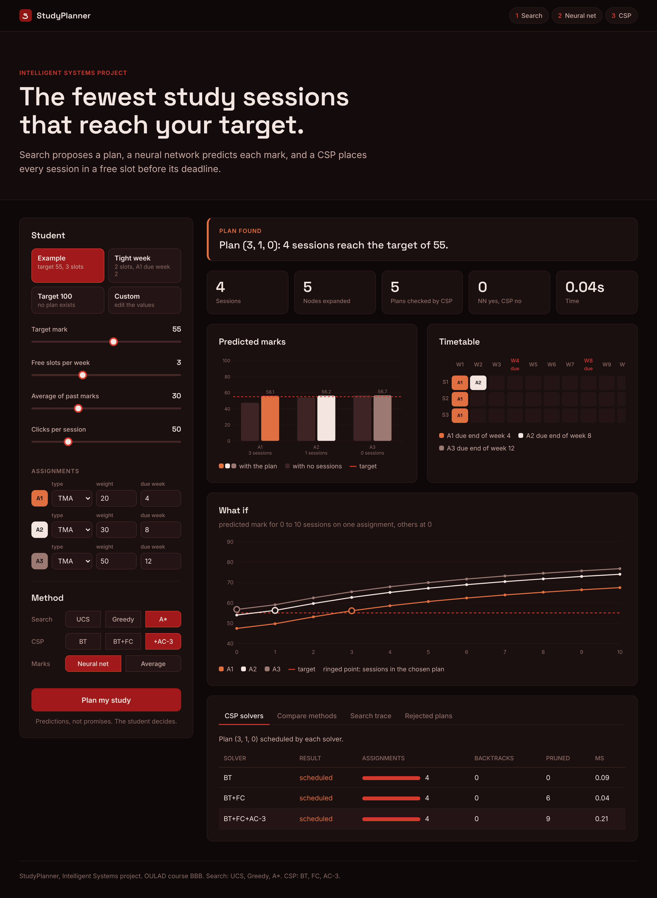
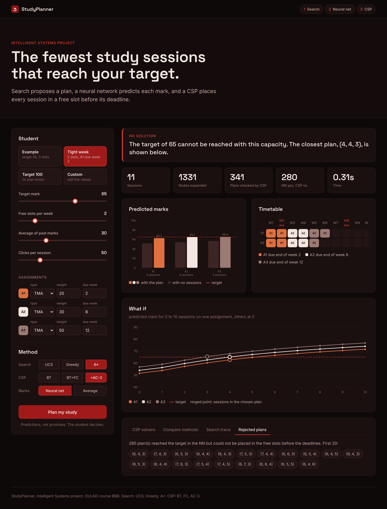
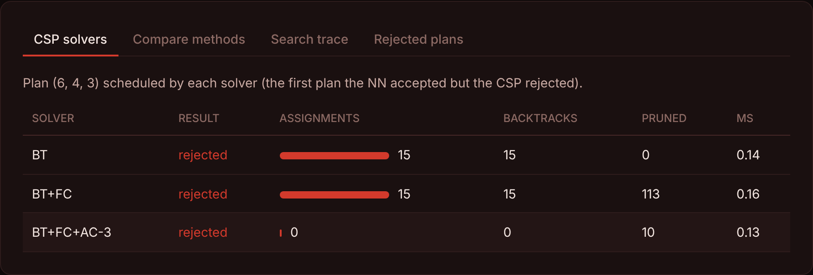
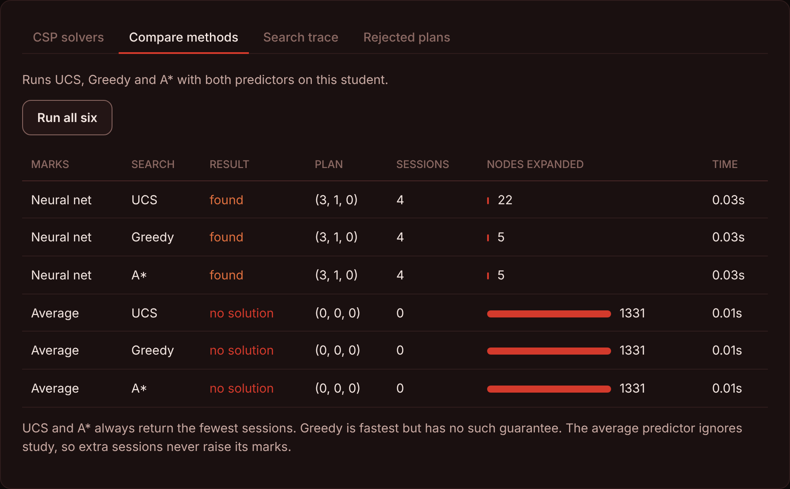
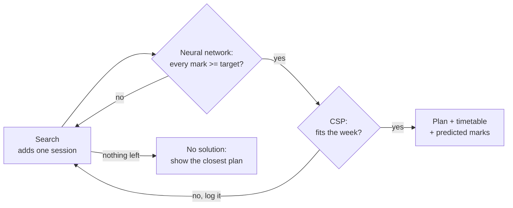

# StudyPlanner

**How many study sessions does each assignment need, and when should they happen?**

StudyPlanner is a decision-support tool for distance-learning students. Given a target mark, a few
free study slots per week and three upcoming assignments, it finds the **fewest study sessions**
whose predicted marks reach the target, and places every session in a free slot before its deadline.

It combines three techniques from the Intelligent Systems course on real Open University data
(OULAD, course BBB):

| Technique | Role in the planner | Code |
| --- | --- | --- |
| **Neural network** | Predicts each assignment's mark from past marks and online activity. Monotone: more study never lowers the prediction. | `nn/` |
| **Search** (UCS, Greedy, A*) | Proposes plans, adding one session at a time, to find the cheapest plan that reaches the target. | `search/` |
| **CSP** (Backtracking, Forward Checking, AC-3) | Places every planned session in a weekly slot before its deadline, or proves that it cannot be done. | `csp/` |



> StudyPlanner shows "what-if" predictions, not promises. The link between online activity and marks
> in the data is observational, not proof of cause. See [Limitations](#limitations).

## Contents

- [Quick start](#quick-start)
- [Using the web app](#using-the-web-app)
- [How it works](#how-it-works)
- [Command-line demo](#command-line-demo)
- [Reproducing the results](#reproducing-the-results)
- [Results](#results)
- [Project layout](#project-layout)
- [Documentation](#documentation)
- [Tests](#tests)
- [Limitations](#limitations)
- [Team](#team)

## Quick start

You need Python 3.11 or newer. The trained network weights are in the repository, so you do not
need to download any data to try the planner.

```bash
git clone https://github.com/Abdo-Kahrawi/StudyPlanner.git
cd StudyPlanner
python -m venv .venv
.venv\Scripts\activate             # Windows.  Linux / macOS: source .venv/bin/activate
pip install -r requirements.txt
python -m webapp                   # opens http://localhost:8000  (Ctrl+C to stop)
```

Options: `python -m webapp --port 8080` for another port, `--no-browser` to skip opening the
browser. The server is Python's built-in `http.server`; it needs no extra packages.

## Using the web app

**1. Set up a student (left panel).** Pick a preset or edit the values.

| Input | Meaning |
| --- | --- |
| Preset | **Example** (target 55, 3 slots), **Tight week** (2 slots, first deadline in week 2), **Target 100** (no plan exists), or **Custom** |
| Target mark | Every predicted mark must reach it |
| Free slots per week | How many study sessions fit in one week |
| Average of past marks | The student's history, used by the neural network |
| Clicks per session | How much online activity one planned session adds |
| Assignments | Type (TMA or CMA), weight and due week of each assignment |
| Method | Search (UCS, Greedy, A*), CSP solver (BT, BT+FC, +AC-3), mark predictor (neural net or average) |

**2. Press "Plan my study" and read the result (right panel).**

| Part | What it shows |
| --- | --- |
| Banner | The plan, for example `(3, 1, 0)`: 3 sessions for A1, 1 for A2, none for A3. Or "No solution" with the closest plan. |
| Sessions | Total sessions in the plan |
| Nodes expanded | Plans the search took off its frontier and tested |
| Plans checked by CSP | Different plans sent to the CSP (each plan is checked once) |
| NN yes, CSP no | Plans whose marks reach the target but that do not fit the week |
| Time | Seconds for search plus CSP |
| Predicted marks | Mark with no sessions (dark bar) and with the plan (coloured bar), against the target line |
| Timetable | The CSP's answer: one cell per session, weeks across, slots down |
| What if | Predicted mark for 0 to 10 sessions on each assignment |

**3. Open the detail tabs.**

- **CSP solvers:** the same plan scheduled by BT, BT+FC and BT+FC+AC-3, with assignments,
  backtracks and pruned values.
- **Compare methods:** UCS, Greedy and A* with both predictors, side by side.
- **Search trace:** how close each expanded plan was to the target.
- **Rejected plans:** the plans the neural network accepted but the CSP rejected.

When the week is too tight, the planner says so and shows the closest plan it could schedule:



The three CSP solvers on a plan that cannot be scheduled. AC-3 proves it before the search starts:



All three searches with both predictors on the example student:



## How it works



- **State:** a plan `(s1, s2, s3)`, the number of sessions per assignment. Search starts at
  `(0, 0, 0)`; each action adds one session and costs 1, so the cheapest goal has the fewest sessions.
- **Neural network:** each session adds clicks to that assignment's four weeks before the deadline
  (`nn/effort.py`), and the network predicts the mark. An effort branch with positive weights
  guarantees that more sessions never lower the predicted mark.
- **Goal test:** every predicted mark reaches the target **and** the CSP can schedule the plan.
- **CSP:** one variable per session, domain = the (week, slot) pairs before that assignment's
  deadline, constraints = no two sessions in one slot, and sessions of an assignment stay in order.
- **A\* heuristic:** for each assignment, the mark still missing divided by the largest gain one
  session can give, rounded up, summed over the assignments. It never overestimates, so A* returns
  the same optimal plan as UCS with fewer expanded nodes.
- **No solution:** if all 1,331 plans (0 to 10 sessions per assignment) fail, the planner reports
  that the target is unreachable at this capacity and shows the closest plan.

## Command-line demo

```bash
python run_demo.py                          # the worked example: plan (3, 1, 0)
python run_demo.py --profile tight          # the NN says yes, the CSP says no
python run_demo.py --profile impossible     # target 100: a clear "no solution"
python run_demo.py --strategy greedy --csp bt --trace
python run_demo.py --compare-predictors     # neural network vs average predictor
python run_demo.py --profile 7 --real       # profile 7 built from OULAD (needs the data)
```

Saved output of these runs is in `docs/demo_backup/`.

## Reproducing the results

Step 1 downloads OULAD into `data/raw/` if it is not there (or put the CSV files there yourself).
Run everything from the repository root.

```bash
python -m data.make_data              # 1. raw OULAD -> data/processed/{train,test}_data.csv (seed 42)
python -m nn.train --seed 42          # 2. train the monotone network, compare with baselines -> nn/weights/
python -m eval.monotonicity --real    # 3. monotonicity check and violation report
python -m eval.run_profiles --real    # 4. planner output for 30 OULAD profiles
python -m eval.exp1_planner --real    # 5. Experiment 1: UCS vs Greedy vs A*
python -m eval.exp2_csp --real        # 6. Experiment 2: BT vs BT+FC vs BT+FC+AC-3
python -m eval.exp3_planner --real    # 7. Experiment 3: neural network vs average predictor
python -m eval.exp3_nn_vs_avg         #    standalone RMSE and MAE of the two predictors
python -m eval.exp1_search            #    standalone search comparison on training rows
```

Tables (CSV) and plots (PNG) are written to `results/`. To also train the plain MLP used as a
comparison in Experiment 3:

```bash
python -m nn.train --arch mlp --save_path nn/weights/mlp/nn_weights.pt --scaler_path nn/weights/mlp/scaler.npz --log_path nn/weights/mlp/train_log.json --comparison_path nn/weights/mlp/baseline_comparison.txt
```

## Results

Real OULAD data, course BBB: trained on presentations 2013B, 2013J and 2014B (35,601 rows), tested
on the later presentation 2014J (7,399 rows). Experiments use 30 test profiles and 5 seeds. The full
tables are in [`docs/results.md`](docs/results.md).

| Question | Result |
| --- | --- |
| How accurate is the network? | Test RMSE 29.8 marks, against 30.1 for the mean mark and 38.4 for the student's previous average |
| Does more study ever lower the prediction? | Never with the monotone network (0% of steps). The plain MLP dropped on 39% of steps. |
| Experiment 1: which search? | At target 80, A* expands 34.5 nodes against 124.9 for UCS, with the same optimal plans. Greedy expands 8.9 but has no guarantee. |
| Experiment 2: which CSP solver? | At 2 slots per week, AC-3 needs 0 backtracks against 11.7 for BT and BT+FC. At 3 or 4 slots all three are equally easy. |
| Experiment 3: does the network matter? | At target 80 the planner solves 25% of profiles with the monotone network and 0% with the average predictor or the plain MLP. |

## Project layout

| Path | Owner | Purpose |
| --- | --- | --- |
| `common/` | Abdo + Zeyad | Shared types (the contract between modules), configuration, stubs |
| `data/make_data.py`, `data/schema.py` | Abdo | Build the training and test tables from raw OULAD |
| `data/profiles.py` | Zeyad | Student profiles: demo students and 30 OULAD profiles |
| `nn/` | Abdo | Network, training, baselines, the sessions-to-clicks rule |
| `search/` | Abdo | UCS, Greedy, A* with node counters |
| `csp/` | Zeyad | Backtracking, Forward Checking, AC-3 with counters |
| `integration/` | Zeyad | `plan_for()`: the search, network and CSP loop |
| `eval/` | Zeyad (harness, Experiment 2), Abdo (Experiments 1 and 3) | Experiments over 5 seeds, plots, monotonicity check |
| `run_demo.py` | Zeyad | Command-line demo |
| `webapp/` | Zeyad | Web app: `server.py` (API) and `static/` (page) |
| `tests/` | each owner | 120 tests |
| `docs/` | both | Report, guides, results, screenshots |

## Documentation

| File | Contents |
| --- | --- |
| [`docs/StudyPlanner_report.pdf`](docs/StudyPlanner_report.pdf) | The final report |
| [`docs/presentation_guide.md`](docs/presentation_guide.md) | Every slide and every web app number explained, split by presenter |
| [`docs/results.md`](docs/results.md) | All result tables from the real-data run |
| [`docs/data_dictionary.md`](docs/data_dictionary.md) | Every column: source, real or generated, cleaning rules |
| [`docs/demo_backup/`](docs/demo_backup/) | Saved demo output, in case the live demo fails |

## Tests

```bash
pytest -q        # 120 tests, about 20 seconds
```

The tests cover the CSP solvers and their counters, the search algorithms on a case with a known
answer, the monotonicity of the network, the planner (5 normal, 3 edge and 2 impossible cases), the
30-profile run, and the web app (every preset with every search, CSP solver and predictor).

## Limitations

- **Accuracy.** A test RMSE near 30 marks is large. The 2014J cohort differs from the training years.
- **Correlation, not cause.** Clicks and marks are observed together. More clicks may reflect
  stronger or more motivated students. Monotonicity is a design choice, not a finding.
- **Assumed parameters.** "One session adds a fixed number of clicks" is an assumption. Free slots
  and targets are generated with a fixed seed, because OULAD does not contain them.
- **One course.** Only BBB. Other courses would need retraining.
- **Excluded on purpose:** gender, age, region, education, disability and deprivation band.

## Team

- **Abdo Kahrawi**, prediction side: data, neural network, search, Experiments 1 and 3.
- **Zeyad Salem**, scheduling side: CSP, integration, evaluation harness, Experiment 2, demo, web app.

Dataset: [Open University Learning Analytics Dataset (OULAD)](https://analyse.kmi.open.ac.uk/open_dataset),
CC BY 4.0. Kuzilek J., Hlosta M., Zdrahal Z. *Open University Learning Analytics dataset*,
Scientific Data 4, 170171 (2017).
